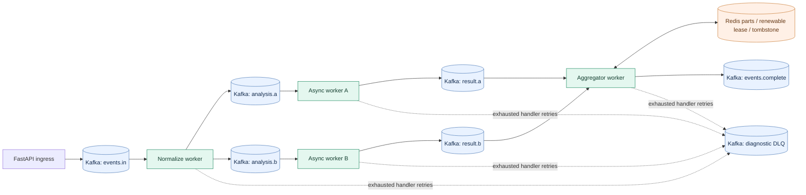
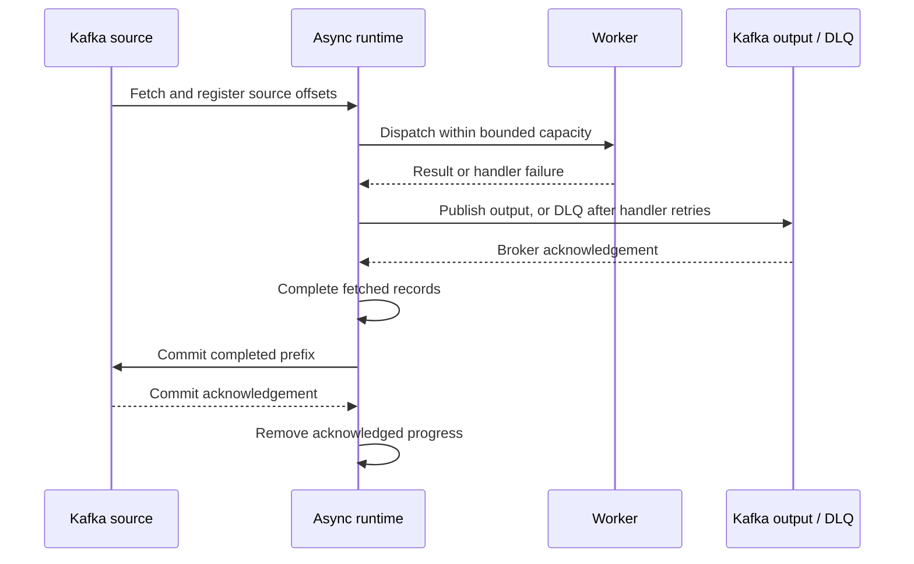

# QF · FastAPI + asyncio

[](https://github.com/bogdancstrike/qf-framework-fastapi/actions/workflows/ci.yml)


[](LICENSE)

**Build HTTP APIs and reliable Kafka worker pipelines with familiar QF decorators, powered by FastAPI and asyncio.**

Declare a worker, choose its input/output topics, and let the runtime manage consumption, bounded concurrency, retries, output acknowledgements and source commits. Combine single-message workers, bulk processing and Redis-backed joins in the same application. Existing synchronous workers, uppercase `config.Config` files, endpoint JSON mappings and tracing helpers remain supported through documented migration paths.

```python
from framework.decorators import kafka_handler, retry_to_dlq


@retry_to_dlq(max_attempts=3, dlq_topic="text.dlq")
@kafka_handler(
    name="normalize", topics_in=["text.in"], topics_out=["text.normalized"], max_workers=16
)
async def normalize(message, consumer_name, metadatas):
    return {**message, "text": message["text"].strip()}
```

> Delivery is **at least once**, with optional Redis replay deduplication. Benchmarks and failure tests are included; their results and limits are documented. This project is an independent successor to QF Flask, not an in-place WSGI replacement.

[Quickstart](#quickstart) · [Worker recipes](#worker-recipes) · [Benchmarks](#measured-benchmarks) · [Tracing](#observability-and-distributed-tracing) · [Migration](docs/Migration.md) · [Full comparison](docs/qf_flask_vs_qf_fastapi_report.md)

## What you get

| Area | Capabilities |
|---|---|
| HTTP | FastAPI/Uvicorn, native ASGI routes, OpenAPI, interactive docs, compiled JSON endpoint mappings, Pydantic validation |
| Workers | Async handlers, bounded executors for sync handlers, per-worker concurrency, bulk size/age flushing, fanout and filtering |
| Pipelines | aiokafka consumer/producer, topic routing, partition backpressure, Redis correlation joins and deterministic merge order |
| Reliability | Manual ACK-gated commits, failed-commit retention, numeric offset gaps, assignment generation fencing, bounded shutdown |
| Retries | Separate application/transport budgets, exponential backoff with full jitter, fresh inputs, diagnostic DLQ |
| Idempotency | Idempotent Kafka producer, optional source-coordinate Redis ledger, renewable aggregate claims, completion tombstones |
| Policies | Worker retry/rate/circuit decorators and function-level retry/rate/circuit wrappers, async and sync support |
| Observability | Prometheus, liveness/readiness, structured JSON logs, sanitized request IDs, W3C trace propagation, optional OTLP export |
| Developer experience | Validated environment settings, legacy Config bridge, runnable examples, Dockerfile, CI, unit/E2E/stress/load benchmarks |

## A pipeline, end to end



Kafka carries durable stage boundaries. Workers transform messages and publish acknowledged outputs. Redis stores incomplete join parts and coordinates ownership of completed correlations. Replicas in the same consumer group share input partitions. Declare one worker per topic in a process; use separate groups when multiple applications must each consume the same topic.

## Quickstart

Requires **Python 3.11+**. Install in a separate environment from QF Flask: both distributions export `framework`.

```bash
git clone https://github.com/bogdancstrike/qf-framework-fastapi.git
cd qf-framework-fastapi
python3 -m venv .venv
source .venv/bin/activate
pip install -e '.[dev,tracing]'
uvicorn examples.app:app --port 4000
```

The bundled example starts HTTP without Kafka or Redis:

```bash
curl -X POST http://localhost:4000/examples/echo/42 \
  -H 'Content-Type: application/json' -d '{"text":"hello asyncio"}'
# {"id":42,"operation":"echo","payload":{"text":"hello asyncio"}}

curl http://localhost:4000/health/ready
curl http://localhost:4000/metrics
```

Open [interactive API docs](http://localhost:4000/docs), [OpenAPI JSON](http://localhost:4000/openapi.json), `/health/live`, `/health/ready` and `/metrics`.

### Enable the bundled Kafka workers

```bash
docker compose -p qf-fastapi-test up -d --wait
cp .env.example .env
# Set QSINT_ENABLE_ETL=true in .env, then restart Uvicorn.
uvicorn examples.app:app --port 4000
```

From a second terminal, publish a message and read its result:

```bash
printf '%s\n' '{"id":"demo-1","text":"  hello pipeline  "}' | \
  docker compose -p qf-fastapi-test exec -T kafka \
  /opt/kafka/bin/kafka-console-producer.sh \
  --bootstrap-server kafka:9092 --topic text.in

docker compose -p qf-fastapi-test exec -T kafka \
  /opt/kafka/bin/kafka-console-consumer.sh \
  --bootstrap-server kafka:9092 --topic text.normalized --from-beginning --max-messages 1
```

Local infrastructure endpoints: Kafka `localhost:29092`, Redis `localhost:26379`, Jaeger UI `http://localhost:26686`, OTLP gRPC `http://localhost:24317`. The compose stack is development infrastructure with one Kafka broker; it is not a replicated production deployment.

## Create your own application

### Native settings and routes

Save as `main.py`:

```python
from framework.app import FrameworkApp
from framework.config import FrameworkSettings

settings = FrameworkSettings(enable_etl=False, enable_dynamic_endpoints=False)
framework = FrameworkApp(settings)
app = framework.build_app()


@app.get("/hello/{name}")
async def hello(name: str):
    return {"hello": name}
```

Run `uvicorn main:app --port 4000`. Native FastAPI routes, dependencies and application state are available alongside framework endpoints.

For a worker application, use:

```python
settings = FrameworkSettings(
    worker_modules=["myapp.workers"],
    kafka_bootstrap_servers="localhost:29092",
    consumer_name="myapp-v1",
    enable_dynamic_endpoints=False,
    redis_url="redis://localhost:26379/0",
)
```

Redis is connected when an aggregator or the optional replay ledger needs it. Ordinary workers require Kafka only.

### Keep your existing `config.py`

```python
from pathlib import Path
from config import Config
from framework.app import FrameworkApp

framework = FrameworkApp.from_config(Config, app_root=Path(__file__).parent)
app = framework.build_app()
```

The bridge supports `WORKER_NAME`, `WORKER_MODULE`/`WORKER_MODULES`, `KAFKA_BOOTSTRAP_SERVERS`, `ERROR_TOPIC`, Redis connection fields and documented tuning keys. Explicit overrides take precedence over environment/dotenv, which take precedence over Config defaults. New environment names use `QSINT_`; lists/dicts use JSON:

```dotenv
QSINT_WORKER_MODULES=["myapp.workers"]
QSINT_CONSUMER_NAME=myapp-v1
QSINT_KAFKA_BOOTSTRAP_SERVERS=localhost:29092
QSINT_PENDING_MAX_PER_TP=750
QSINT_COMMIT_TICK_SEC=0.2
QSINT_IDEMPOTENCY_ENABLED=false
```

See the [complete configuration reference](docs/Configuration.md) and [migration guide](docs/Migration.md). `framework.run()` returns handles; resources start in ASGI lifespan. For worker-only execution, set `enable_api=False` and call `framework.serve()` under a main guard.

## Worker recipes

Every worker receives `(message_or_batch, consumer_name, metadatas)` and returns a dict, list of dicts, or `None`. Native async workers run directly on the event loop. Sync workers run in bounded executors with tracing context propagated. Use async external clients inside `async def`; CPU-heavy work belongs in separate processes/services.

### Fan out to two downstream stages

```python
from framework.decorators import kafka_handler


@kafka_handler(
    name="fanout",
    topics_in=["events.in"],
    topics_out=["analysis.a", "analysis.b"],
    max_workers=16,
)
async def fanout(message, consumer_name, metadatas):
    return message  # The same result is published to both output topics.
```

Every output topic must acknowledge delivery before the source record completes. Preserve a stable `id` across stages for correlation and downstream idempotency.

### Batch by size or age

```python
@kafka_handler(
    name="bulk",
    topics_in=["bulk.in"],
    topics_out=["bulk.out"],
    max_workers=8,
    bulk_mode=True,
    batch_size=32,
    batch_timeout_ms=25,
)
async def bulk(messages, consumer_name, metadatas):
    return [{**message, "processed": True} for message in messages]
```

Batches stay within one source partition. Quiet partitions flush partial batches when the oldest queued record reaches the configured age; admission policies and occupied worker slots can delay actual dispatch. `max_workers` counts batch jobs, while the uncommitted-record bound counts their individual records.

### Join two topics through Redis

```python
from framework.decorators import kafka_aggregator


@kafka_aggregator(
    name="merge",
    topics_in=["result.a", "result.b"],
    topics_out=["events.complete"],
    aggregate_by="id",
    aggregator_timeout_sec=300,
    max_workers=8,
)
async def merge(message, consumer_name, metadatas):
    return {**message, "complete": True}
```

Publish `{"id":"job-42","a":true}` to `result.a` and `{"id":"job-42","b":true}` to `result.b`. The handler receives their merged object once the correlation is complete. Merge precedence follows `topics_in` order; later topics win conflicts. Renewable token-checked claims serialize ownership, and completion tombstones suppress repeated correlations within the timeout window. Redis durability and expiry determine the recovery boundary.

### Keep a synchronous integration

```python
@kafka_handler(name="legacy", topics_in=["legacy.in"], topics_out=["legacy.out"], max_workers=4)
def legacy(message, consumer_name, metadatas):
    return {**message, "processed_by": consumer_name}
```

Existing blocking integrations can stay synchronous while other workers adopt async clients. Threads cannot be forcibly stopped once user code is running; side effects still need idempotency.

### Filter a message

```python
@kafka_handler(name="filter", topics_in=["audit.in"], topics_out=["audit.accepted"])
async def filter_audit(message, consumer_name, metadatas):
    if message.get("ignore"):
        return None  # Intentional successful filtering; the input may be committed.
    return message
```

Use `@retry_to_dlq`, `@rate_limit` and `@circuit_breaker` for worker policies; function-level `call_retry`, `call_rate_limit` and `call_circuit_breaker` are also exported. Their arguments and behavior are documented in [Migration.md](docs/Migration.md) and the decorator modules.

## JSON endpoint mappings

Existing namespace/model/endpoint declarations are compiled once into FastAPI routes and Pydantic schemas. Example `maps/endpoint.json`:

```json
{
  "namespaces": [{"name": "examples", "description": "Example API"}],
  "models": {
    "Echo": {"text": {"type": "string", "args": {"required": true}}}
  },
  "endpoints": [{
    "namespace": "examples",
    "operation_name": "echo",
    "model_name": "Echo",
    "request_method": ["POST"],
    "api_url": "/examples/echo/<int:item_id>",
    "exec_method": {"module_name": "examples.handlers", "method_name": "echo"}
  }]
}
```

Native async handlers receive a Starlette request:

```python
async def echo(app, request, operation, item_id: int):
    return {"id": item_id, "operation": operation, "payload": await request.json()}
```

### Endpoints without a model

Use JSON `null` (Python `None`) or omit `model_name` to skip schema validation:

```json
{
  "namespace": "examples",
  "operation_name": "ping",
  "model_name": null,
  "request_method": ["GET"],
  "exec_method": {"module_name": "examples.handlers", "method_name": "ping"}
}
```

No request body is required. For POST/PUT/PATCH/DELETE, valid arbitrary JSON is passed through without a Pydantic model; malformed JSON still returns 400. The top-level `models` may also be omitted or set to `null`, and an explicitly named model definition may be `null`. In JSON, spell the value `null`, not the string `"None"`. Try `curl http://localhost:4000/examples/ping` in the bundled example.

Legacy sync handlers receive a compatibility adapter with `get_json()`, `json`, `args` and `headers`; `(body, status)` and `(body, status, headers)` responses work. Flask globals/extensions require migration. See the [runnable endpoint example](examples/maps/endpoint.json).

## How reliability works



- **Bounded backpressure:** queues, active jobs and all fetched records awaiting commit are bounded, including completed records behind a slow predecessor.
- **Safe progress tracking:** commits follow actual fetched offsets, permit numeric gaps, and never advance past unfinished fetched work. Failed commits retain their candidates.
- **Separate retry budgets:** handler failures retry with fresh input copies and jitter; transport retries do not needlessly rerun successful user code.
- **Visible terminal failure:** exhausted output/DLQ/commit budgets fail readiness and leave uncommitted input available for replay.
- **Rebalance and shutdown:** bounded drain, cancellation, generation fencing and final acknowledged progress commits.

There is an output-ACK-to-source-commit crash window. Optional `QSINT_IDEMPOTENCY_ENABLED=true` adds a Redis source-coordinate completion ledger, narrowing completed replay duplication but retaining an ACK-to-ledger crash window and finite TTL. It does not deduplicate arbitrary repeated business IDs at new offsets. Producer idempotence, Redis leases and tombstones do not make external effects exactly once. Read [operations and recovery](docs/Operations.md) for detailed boundaries and DLQ replay instructions.

## Observability and distributed tracing

| Endpoint / signal | What to inspect |
|---|---|
| `/health/live` | HTTP availability |
| `/health/ready` | Startup/shutdown state and ETL runtime health |
| `/metrics` | Worker outcomes/retries/duration, queues, uncommitted records, inflight jobs, partition lag, circuits and scheduler delay |
| JSON logs | Request IDs, active trace/span IDs and structured failure events |
| OTLP / Jaeger | HTTP and downstream worker spans connected through W3C Kafka headers |

```dotenv
QSINT_ENABLE_TRACING=true
QSINT_OTLP_ENDPOINT=http://localhost:24317
QSINT_OTLP_INSECURE=true
QSINT_SERVICE_NAME=my-worker
```

Tracing is optional and disabled by default. Install `.[tracing]`; use TLS with your production collector. Existing helpers remain available:

```python
from framework.tracing import get_tracer, inject_trace_headers

with get_tracer().start_as_current_span("application.enrich") as span:
    span.set_attribute("application.stage", "enrich")
    # Worker output propagation is automatic.
    # For manual publishes: headers=inject_trace_headers()
```

The real collector test crosses **four independent processes**, HTTP, Kafka fanout and a Redis join, then queries Jaeger to verify one trace ID and resolvable parent links. Archived proof: [verification](benchmarks/results/jaeger_verification.json) and [full trace](benchmarks/results/jaeger_trace.json). Open the `ui_url` in the verification file while the local Jaeger container is running. See [Tracing.md](docs/Tracing.md) for batch lineage, join parenting and custom publication.

## Measured benchmarks

Worker throughput measures one stage: Kafka → worker → Kafka. The four-process fanout/join is a separate correctness and tracing test. Results come from real local Kafka/Redis and loopback HTTP on an AMD Ryzen 9 9950X3D host, Python 3.12.3. Raw repetitions, dependency versions, CPU/RSS and latency percentiles are included. These are finite synthetic workloads on one broker, not production capacity guarantees.

<!-- BENCHMARK_TABLES_START -->
### Kafka workers · 1,000 messages, eight jobs

Three repetitions per cell; all 48 final worker trials completed with no missing/duplicate/DLQ records. Throughput is measured to observed final output; the report also includes committed-offset throughput.

| Workload | Stock Flask msg/s | Flask ACK variant msg/s | FastAPI async msg/s | Async p95 ms |
| --- | --- | --- | --- | --- |
| Identity | 11,020 | 301 | 1,397 | 662.08 |
| 5 ms I/O / message | 300 | 298 | 1,331 | 694.40 |
| 32-record bulk, 5 ms / job | 1,696 | 1,712 | 15,990 | 39.28 |
| 10% transient retry | 6,351 | 319 | 1,388 | 666.40 |

### Larger bulk bursts · 5,000 messages, 32 jobs

| Engine | Successful trials | Median msg/s | Median p95 ms |
|---|---|---:|---:|
| async | 3/3 | 14,136 | 165.43 |
| sync | 3/3 | 14,454 | 196.21 |
| original_ack | 2/3 | 18,202 | 133.11 |

One original trial reached the 60-second deadline and is excluded from successful-trial medians; its cause was not isolated by the harness. The original ACK variant only changes output waiting, not its other reliability defects.

<!-- SCALE_COMPARISON_START -->
## Processing 1,000 versus 100,000 messages

In progress: 21 of 24 planned trials recorded. All 100,000-message numbers are preliminary until three repetitions per engine/workload finish.

Same four partitions, eight worker jobs and three repetitions per engine/workload. The comparator is the **original ACK-gated harness variant**; it changes single-output waiting without repairing the original's other reliability defects. Output time measures the complete input burst to final observed output. Throughput is messages/second; higher is better. Time is seconds; lower is better.

| Workload | Messages | Flask ACK output s | Async output s | Flask ACK msg/s | Async msg/s | Async / Flask rate | Flask passed/attempted | Async passed/attempted |
| --- | --- | --- | --- | --- | --- | --- | --- | --- |
| Identity | 1,000 | 3.32 | 0.72 | 301.30 | 1,397.27 | 4.64× | 3/3 | 3/3 |
| Identity | 100,000 | 144.23 | 72.34 | 693.33 | 1,382.42 | 1.99× | 3/3 | 3/3 |
| 5 ms I/O / message | 1,000 | 3.36 | 0.75 | 297.69 | 1,331.21 | 4.47× | 3/3 | 3/3 |
| 5 ms I/O / message | 100,000 | 376.17 | 74.92 | 265.84 | 1,334.74 | 5.02× | 3/3 | 3/3 |
| 32-record bulk | 1,000 | 0.58 | 0.06 | 1,712.00 | 15,990.23 | 9.34× | 3/3 | 3/3 |
| 32-record bulk | 100,000 | 49.70 | 5.99 | 2,012.00 | 16,707.12 | 8.30× | 3/3 | 3/3 |
| 10% transient retry | 1,000 | 3.13 | 0.72 | 319.20 | 1,388.38 | 4.35× | 3/3 | 3/3 |
| 10% transient retry | 100,000 | 290.18 | 71.57 | 344.61 | 1,397.14 | 4.05× | 1/1 | 2/2 |

Each cell is a median across successful trials. `0/0` means not yet attempted; failed attempts remain in the success counts and raw data. A ratio of 2.00× means twice the throughput, approximately half the elapsed time for the same count; a ratio below 1.00× favors Flask.

### Source-commit completion time

This separately waits until the broker reports source offsets committed through the published inputs. It is not atomic output-plus-input delivery or an exactly-once guarantee.

| Workload | Messages | Flask ACK commit s | Async commit s | Flask ACK commit msg/s | Async commit msg/s |
| --- | --- | --- | --- | --- | --- |
| Identity | 1,000 | 3.34 | 0.73 | 299.36 | 1,374.06 |
| Identity | 100,000 | 144.25 | 72.37 | 693.23 | 1,381.81 |
| 5 ms I/O / message | 1,000 | 3.40 | 0.77 | 293.99 | 1,294.92 |
| 5 ms I/O / message | 100,000 | 376.21 | 74.92 | 265.81 | 1,334.74 |
| 32-record bulk | 1,000 | 0.61 | 0.07 | 1,651.10 | 14,313.64 |
| 32-record bulk | 100,000 | 49.72 | 5.99 | 2,011.07 | 16,705.26 |
| 10% transient retry | 1,000 | 3.13 | 0.73 | 319.15 | 1,374.37 |
| 10% transient retry | 100,000 | 290.18 | 71.60 | 344.61 | 1,396.72 |
<!-- SCALE_COMPARISON_END -->

### HTTP · 1,000 requests per trial

| Workload | Clients | Flask req/s | FastAPI req/s | Flask p95 ms | FastAPI p95 ms |
| --- | --- | --- | --- | --- | --- |
| noop | 1 | 2,105 | 2,397 | 0.60 | 0.52 |
| noop | 16 | 1,443 | 1,408 | 38.40 | 38.10 |
| noop | 64 | 1,335 | 1,300 | 131.03 | 133.79 |
| noop | 256 | 901 | 834 | 752.13 | 765.55 |
| io | 1 | 169 | 171 | 6.09 | 6.11 |
| io | 16 | 1,784 | 1,849 | 15.83 | 14.63 |
| io | 64 | 662 | 703 | 294.46 | 280.58 |
| io | 256 | 639 | 689 | 1,019.39 | 927.29 |

All 48 HTTP trials completed with zero errors. Results include client connection-pool effects; high concurrency is not a server-capacity certification.
<!-- BENCHMARK_TABLES_END -->

The stock Flask single-message path can be faster by returning before output ACK. The explicitly labeled `original_ack` harness variant waits for single-message output ACKs, but retains the original coordinator/DLQ/aggregation defects. HTTP results are mixed and include load-driver contention at high concurrency. Large-batch tests exposed a fetch-wait bottleneck: reducing the new consumer's configurable default from 500 to 50 ms improved the measured 5,000-record bulk workload, while successful original bulk runs remained competitive. The report includes timeout trials and successful-trial counts.

[Full methodology and comparison](docs/qf_flask_vs_qf_fastapi_report.md) · [Raw measurements](benchmarks/results) · [Reproduction guide](benchmarks/README.md)

## Test and benchmark it yourself

```bash
# Unit / regression checks; live-service tests skip by default.
python -m pytest -q
ruff check .
ruff format --check .
python -m build

# Real Kafka + Redis, including process crash / restart.
QF_INTEGRATION=1 python -m pytest tests/test_e2e.py tests/test_crash_recovery.py -v

# Real OTLP export and linked spans queried from Jaeger.
QF_JAEGER=1 python -m pytest tests/test_otlp_jaeger.py -v

# Stress: 10,000 records, transient handler failures and bounded capacity.
QF_INTEGRATION=1 QF_STRESS_MESSAGES=10000 python -m pytest tests/test_e2e.py -k stress -v

# Explicit broker outage test: pauses only the dedicated test Kafka container.
QF_INTEGRATION=1 QF_CHAOS=1 python -m pytest tests/test_chaos.py -v

# Run benchmark suites sequentially, outside failure-injection tests.
python benchmarks/compare_pipelines.py --messages 1000 --repeats 3
python benchmarks/compare_http.py --requests 1000 --repeats 3
```

The complete local validation snapshot passed **132 tests**, including Kafka/Redis, 10,000-record stress, SIGKILL recovery, broker outage and real Jaeger checks. The default profile runs 120 unit/regression tests and skips 12 opt-in live tests; see [validation evidence](benchmarks/results/validation.json).

Tests cover failed commits, out-of-order completion, numeric gaps, malformed input, output/DLQ failure, async/sync/bulk/aggregate workers, concurrency, lease renewal, crash replay, overload bounds, shutdown, schema validation and trace propagation. CI runs Python 3.11/3.12/3.13 checks and dedicated service integration tests. See [benchmarks/README.md](benchmarks/README.md) for original-environment setup and every test profile.

## Project map

```text
src/framework/
  api/           FastAPI factory, middleware and JSON route compiler
  app/           FrameworkApp and lifespan / worker-only runner
  config/        Validated settings and legacy Config bridge
  decorators/    Worker registration, retry/rate/circuit and locking policies
  etl/           Bounded scheduler, processing and commit coordinator
  redis/         Async helpers, aggregation and optional replay ledger
  streams/       Async Kafka convenience client
  tracing/       W3C propagation and optional OTLP provider
  commons/       JSON logging and retained domain utilities
examples/        Runnable HTTP, worker and configuration examples
tests/           Unit, live integration, stress, crash and tracing checks
benchmarks/      Matched original/new harnesses and tracked raw results
docs/            Specifications, architecture, operations and comparison
```

## Documentation and contributing

- [Specification](docs/specs.md), [architecture](docs/architecture.md), [task status](docs/tasks.md)
- [Migration and compatibility](docs/Migration.md), [configuration](docs/Configuration.md)
- [Operations and failure recovery](docs/Operations.md), [distributed tracing](docs/Tracing.md)
- [Original code analysis](docs/Analysis.md), [Flask versus FastAPI comparison](docs/qf_flask_vs_qf_fastapi_report.md)
- [Testing and benchmark guide](benchmarks/README.md)

For changes, install `.[dev,tracing]`, add focused behavioral regressions, and run lint plus the relevant test profile. Include benchmark methodology and raw results for performance claims. Report reproducible bugs and improvement proposals through [GitHub issues](https://github.com/bogdancstrike/qf-framework-fastapi/issues). Production multi-broker failover, Redis data-loss recovery and long soak capacity remain deployment-specific validation work.

Released under the [MIT license](LICENSE). The QF API patterns and retained utility code originate from the existing QSINT framework.
