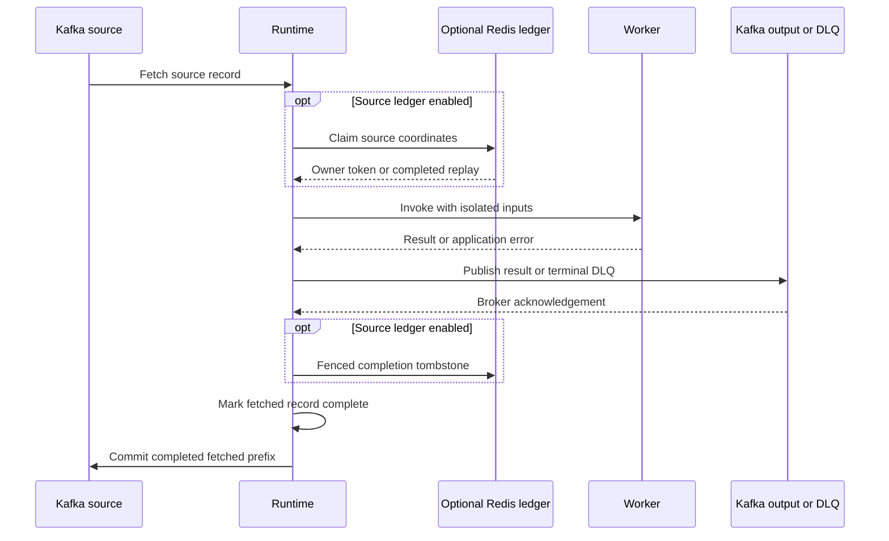
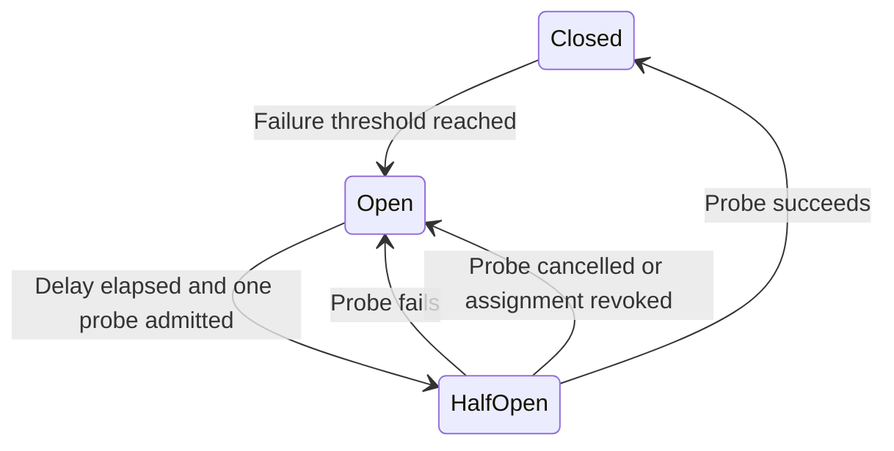

# Extending QF without weakening delivery guarantees

Start with ordinary async Python functions, explicit resource ownership and the
existing decorators. Most applications need new workers and configuration rather
than a new scheduler or framework subclass. The runnable [example tutorial](../examples/README.md)
shows HTTP ingress, fan-out, joins, retries and tracing together.

## Extension points and ownership

| Need | Supported boundary | Contract |
|---|---|---|
| New processing step | `@kafka_handler` | Async function receives `(message, consumer_name, metadatas)`; returns dict, list of dicts or `None` |
| Correlate branches | `aggregator=True, aggregate_by="order.id"` | One part per input topic per correlation; nested dictionaries merge in configured topic order |
| Local failure policy | `retry_to_dlq`, `circuit_breaker`, `rate_limit` | Metadata interpreted by the runtime; separate handler and transport retry budgets |
| Application HTTP routes | `settings.init_app` or the built FastAPI app | Register routes/dependencies before serving; resource acquisition belongs in lifespan |
| Application HTTP/database clients | Composed FastAPI lifespan and `app.state` | Acquire before the framework lifespan; close after it drains workers |
| Programmatic worker sets | `KafkaRuntime(settings, workers=[...])` | Same validation as decorators; unique worker names and input topics |
| Test transports / composition | Runtime constructor arguments | Injected Kafka transports are started and stopped by the runtime |
| Shared Redis client | `AggregationStore(settings, client=client)` | Store leaves an injected Redis client open; application closes it |
| Alternate application runtime | `FrameworkApp(..., runtime_factory=...)` | Factory accepts settings/metrics; exposes async start/stop and ready/error; worker-only mode also requires task |
| Application-specific configuration | `settings.extra`, worker metadata | Keep credentials in SecretStr-backed settings; avoid mutable globals and import-time clients |
| Per-message results of a bulk call | Return `Outcome` objects | One per message, in order; `ok`/`skip`/`dead_letter`/`retry`; see [importer parity](ImporterParity.md) |
| Dead-letter record layout | `@retry_to_dlq(dlq_format=...)` implementing `DeadLetterFormat.build(letter)` | Return value, key and headers; trace headers are added by the runtime; refused records become a sha256 reference |
| Retry schedule | `@retry_to_dlq(backoff=..., transient_backoff=...)` implementing `Backoff.delay(attempt)` | Seconds to wait; `transient` exception classes retry without a budget |
| Output byte format | `@kafka_handler(encoder=...)` | `Callable[[value], bytes]`; `compact_json` (default) or `python_json` |
| Workers built from application objects | `@kafka_handler` on methods + `collect_workers(owner, resolver, override=)` | Deferred values `(resolver) -> value`; returns validated specs bound to `owner` |
| Isolate and restart worker groups | `KafkaSupervisor(settings, workers, observer=, runtime_factory=)` | One runtime per consumer lane; per-worker `status()`; usable as a `FrameworkApp` runtime |
| Application metrics and status | `WorkerObserver` subclass passed as `observer=` | No-op hooks `on_job`, `on_transient`, `on_recovered`, `on_lag`, `on_state`, `on_restart`; exceptions are logged and ignored |
| Offset operations | `framework.streams.admin.KafkaAdmin` | Lag, offsets for a time, membership, commit without joining |
| Extra consumers and clusters in tests | `KafkaRuntime(consumer_factory=..., producer_factory=...)` | Called per extra lane / per extra cluster; the runtime starts and stops what they return |

Configuration is snapshotted at startup: topic lists and nested worker metadata
are copied. Changing the original `WorkerSpec` containers cannot change an active
subscription. Reconfigure by creating a new runtime. A runtime instance starts
once; create a replacement after shutdown. Explicitly injected worker sets do not
modify the decorator registry.

### Compose a worker set directly

Decorators remain the convenient application API. Constructor injection also
supports isolated applications and tests:

```python
from framework.decorators.kafka_workers import WorkerSpec
from framework.etl.framework_etl import KafkaRuntime


async def enrich(message, consumer_name, metadatas):
    return {**message, "enriched": True}


worker = WorkerSpec(
    kind="handler",
    name="enrich",
    topics_in=["orders.in"],
    topics_out=["orders.enriched"],
    metadatas={},
    max_workers=8,
    fn=enrich,
)
# Inside an application-owned async lifecycle, using validated settings:
# runtime = KafkaRuntime(settings, workers=[worker])
# await runtime.start()
# try:
#     await application_stop.wait()
# finally:
#     await runtime.stop()
```

Prefer native coroutines for network I/O. The compatibility adapter executes sync
workers in per-worker thread pools with copied trace context. Cancelling an await
cannot stop a thread already executing business code. Such code needs its own
network timeouts and independently idempotent side effects.

## Processing and completion are different boundaries



`Processor.handle()` reports `False` when an application failure reaches an
acknowledged DLQ. Success includes filtering with `None`, a stored join part and
a completed replay. Transport exhaustion and lost assignment/lease propagate;
they leave source work uncommitted. Joins propagate the handler's outcome too,
so failed joins contribute to the worker circuit policy.

Lost ownership is ignored only after the Kafka assignment was actually revoked
or replaced. Loss of a processing lease under a still-assigned partition is a
terminal runtime error. This fails readiness/liveness so supervision can restart
and replay the source, rather than silently retaining an unfinished offset gap.

`CommitCoordinator` follows fetched order. Numeric offsets can contain gaps;
it never requires every integer offset to exist. A slower earlier record blocks
committing later completed records. Completion is fenced by assignment identity,
and failed commit RPCs retain progress for retry.

Output ACK, Redis completion and source commit are separate operations. Producer
idempotence does not make external effects or this sequence exactly once. A
process crash after output ACK but before ledger completion can duplicate output.
Use an application business key and database transaction/outbox where your domain
requires stronger guarantees; those remain application responsibilities.

## Worker circuit state under concurrency



Every dispatched job retains an admission generation. Opening a circuit and
starting a probe invalidate older completions. An older success cannot erase a
newly opened circuit, and an older failure cannot reopen a circuit recovered by
its probe. Cancellation releases a probe even if the task never began execution.
The next probe can run after the existing delay has elapsed.

Rate limits and circuit state are **per worker, per runtime process**. Four pods
with `rps=10` can collectively admit approximately 40 jobs/s. A bulk job consumes
one token, not one token per contained record. Fleet-wide quotas are a proposed
feature, not a property of this local policy.

## Join retention and recovery

| State | Retention |
|---|---|
| Waiting for remaining topics | Configured `aggregator_timeout_sec`, refreshed on an accepted arrival |
| Complete and claimed | Parts retain `aggregate_lease_sec + aggregator_timeout_sec` |
| Heartbeat renews ownership | Lease and complete-part retention refresh every lease/3 seconds |
| Owner dies | Replacement has a configured join-timeout window after the last lease expiry to recover retained parts |
| Complete output/DLQ acknowledged and claim finished | Parts/lease removed; done tombstone retains configured join timeout |

The complete-part retention rule prevents a short join timeout from deleting
data while its lease is still valid. Incomplete joins still expire deliberately;
a branch accepted and committed long before its counterpart can be lost from
Redis after that window. Size retention for expected branch delays and recovery,
and monitor Redis durability/capacity. This is a bounded join, not an unbounded
durable workflow engine. See [scaling and recovery](Scaling.md).

## Patterns used, and when to add another abstraction

| Pattern | Concrete use | Extension rule |
|---|---|---|
| Composition / constructor injection | Runtime transports, aggregation store, runtime factory | Inject small collaborators instead of adding a service locator |
| Adapter | Sync worker executor and legacy HTTP request bridge | Keep compatibility at the boundary; prefer native async internally |
| Policy / state machine | Admission, retry budgets, ACK receipt tracking | Test concurrent transitions and cancellation, not only happy-path return values |
| Immutable configuration record | Frozen WorkerSpec with startup snapshots | Replace policy records; avoid mutating live runtime configuration |
| Ownership fencing | Assignment identity and Redis tokens | Reject stale completion rather than trying to repair ownership heuristically |
| Atomic transition | Lua claim/renew/finish/release | Preserve token checks; pipelining does not make multiple scripts one transaction |

Add interfaces when a second implementation needs them. Avoid adding inheritance,
plugin registries or dependency containers simply to wrap existing constructors.
Keep scheduling and commit coordination separate from business handlers. If you
replace a collaborator, retain its cancellation, ownership and acknowledgement
contracts before measuring performance.

Important source entry points:

- [Worker registry and validation](../src/framework/decorators/kafka_workers.py)
- [Runtime lifecycle, scheduling and revoke](../src/framework/etl/framework_etl.py)
- [Worker invocation and retry boundaries](../src/framework/etl/processing.py)
- [Admission generations](../src/framework/etl/policies.py)
- [Contiguous commit coordination](../src/framework/etl/coordinator.py)
- [ACK receipt state machine](../src/framework/streams/delivery.py)
- [Redis atomic claim/retention transitions](../src/framework/redis/aggregation.py)
- [Application composition and cleanup](../src/framework/app/runner.py)

## Tests required when changing a boundary

Run focused unit regressions first, then real-service tests for changes touching
delivery, leases, rebalances or exporter lifetime. Failure scenarios must assert
source offsets and output identities; a successful function return alone is
insufficient. The [five-stage repeated reliability test](../tests/test_pipeline_reliability.py)
checks every intermediate topic and all 20 input partitions per trial.

See [testing](Testing.md) for commands and [audit evidence](RuntimeAudit.md) for
reproduced defects, results and the scope of the CPU optimization measurement.
