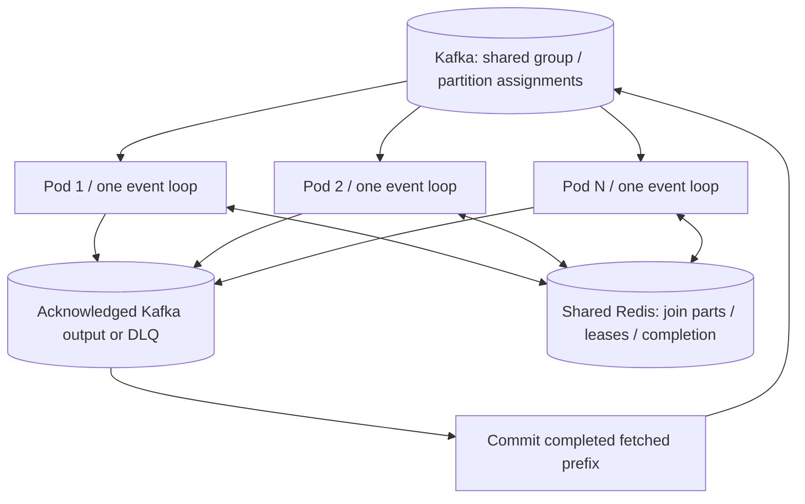

# Horizontal scaling and process restart recovery

Replicas sharing a Kafka consumer group divide input partitions. Restarted processes resume from the group's committed offsets. The framework completes inputs only after acknowledged output/DLQ, intentional filtering, retained join storage or a completed replay-ledger skip. A process kill cannot commit its unfinished in-memory work.

**The contract is at least once.** Uncommitted records replay, including records whose output already reached Kafka. A worker/pod restart should not lose accepted input while Kafka retains it and required Redis state survives. This is not an unconditional guarantee against broker data loss, Redis data loss, expired joins, exhausted retention or non-idempotent external effects.

## How replicas coordinate



Use the same stable `consumer_name`, worker names, input topic sets, aggregate keys and Redis endpoint for replicas of a worker service. A pod name/random startup ID must not be the consumer group or worker name: changing these creates independent consumption and/or a different Redis namespace. During a rolling update, keep message contracts compatible across old/new replicas.

Every member subscribing to a topic must know its matching worker. Run identical subscriptions for replicas of one service. Distinct stages can also run in separate applications/groups, with a stable group per stage. If two different business operations need every record from the same topic, give them different groups.

One topic partition has one assigned consumer per group. Four partitions permit at most four active consuming processes for that topic. A multi-topic group can have more total assignments, but a stage consuming one four-partition topic still has that four-consumer bound. Extra processes remain healthy and idle. `max_workers` controls concurrent jobs within each process; concurrent processing can reorder outputs even within a partition.

Scale on per-stage lag, processing latency and downstream saturation. More pods increase aggregate downstream concurrency, connections and local rate-limit budgets. Current scheduler limits and circuit state are process-local. The recovery tests establish assignment/recovery correctness, not linear throughput scaling or Kubernetes autoscaler behavior.

## What happens when a process dies

| Crash point | Recovery |
|---|---|
| Before handler/output completion | Input remains uncommitted and replays on a replacement/surviving consumer. |
| During fanout | Already ACKed branches may exist; replay can duplicate them. Within one live attempt, retained receipts prevent resending known ACKs. |
| After all output ACKs, before input commit | Replay is expected. An already persisted source-ledger completion suppresses it within the ledger TTL. |
| After ACK, before source-ledger completion | Duplicate output remains possible; no cross-system atomic transaction is implemented. |
| After storing an incomplete join and committing that branch | The replacement needs the retained Redis part when the other branch arrives. Kafka does not automatically replay that committed part. |
| While holding a complete join's lease | Another process waits for release/expiry, then claims retained parts. A dead process cannot renew its lease. |
| After aggregate output ACK, before tombstone completion | Replay may emit another joined output. Downstream business idempotency remains necessary. |

On reassignment the runtime stops dispatch, drains for a bounded interval, cancels unfinished jobs and commits only the completed fetched prefix. Old generation completions cannot advance the new assignment. A synchronous function already running in a thread may continue external effects; cancellation is not a rollback.

All replicas share Redis Lua ownership checks. Related keys share a hash tag; this supports atomic operations on each correlation's keys, but a `redis.asyncio.Redis` client is not a full Redis Cluster discovery/failover client. Supply/deploy an appropriate endpoint and validate topology support separately. Batched ledger operations pipeline individually atomic scripts; the entire batch is not a cross-key transaction.

## Durability requirements

1. Provision Kafka input, output and DLQ topics with replication and sufficient retention for the longest outage/replay horizon. A typical durability configuration is replication factor 3, `min.insync.replicas=2`, `acks=all`, with unclean leader election disabled. Verify internal consumer-offset replication as well. These are infrastructure choices; the local stack has only one broker. See [Kafka broker configuration](https://kafka.apache.org/39/generated/kafka_config.html).
2. Keep Redis join parts and completion receipts available across pod replacement. Do not use a per-pod Redis instance or ephemeral pod volume. Use persistence, backups, memory policy and an accepted failover loss budget. Redis acknowledgement alone is not proof of replicated durable storage. The development AOF `everysec` can lose recent writes on a Redis machine failure.
3. Set `aggregator_timeout_sec` above worst-case branch delay, outages and recovery. It also bounds tombstone suppression. Incomplete joins expire without automatic diagnostic DLQ, so an expired committed part can prevent a final output. If your business requires indefinite/no-silent-expiry recovery, this bounded join contract is insufficient; add an expiry workflow/durable join design before relying on that requirement.
4. Set `idempotency_ttl_sec` above the intended replay horizon, and keep business correlation IDs stable/unique. Source-coordinate deduplication covers existing offsets, not identical payloads at new offsets.
5. Make external business actions idempotent with a unique business constraint or downstream idempotency key. Kafka output, Redis completion, database writes and HTTP calls are separate operations.

`None` intentionally filters a message and a permanently failing handler commits only after a diagnostic DLQ ACK. Monitor/replay DLQ if every business request must eventually succeed. Retry attempts currently reset on crash. Changing/deleting topics or resetting consumer offsets is an operator action outside automatic restart recovery.

## Kubernetes deployment pattern

Use one Uvicorn process per pod. The application image must include your application module and worker contracts. The following template assumes `myapp:app` constructs `FrameworkApp(FrameworkSettings(...))` and uses the environment settings shown:

```yaml
apiVersion: apps/v1
kind: Deployment
metadata:
  name: qf-orders
spec:
  replicas: 4
  selector:
    matchLabels: {app: qf-orders}
  template:
    metadata:
      labels: {app: qf-orders}
    spec:
      terminationGracePeriodSeconds: 150
      containers:
        - name: workers
          image: your-registry/qf-orders:validated-release
          command: [uvicorn, 'myapp:app', --host, '0.0.0.0', --port, '4000', --workers, '1']
          ports:
            - {name: http, containerPort: 4000}
          env:
            - {name: QSINT_ENABLE_ETL, value: 'true'}
            - {name: QSINT_ENABLE_DYNAMIC_ENDPOINTS, value: 'false'}
            - {name: QSINT_WORKER_MODULES, value: '["myapp.workers"]'}
            - {name: QSINT_CONSUMER_NAME, value: orders-v1}
            - {name: QSINT_KAFKA_BOOTSTRAP_SERVERS, value: 'kafka:9092'}
            - {name: QSINT_IDEMPOTENCY_ENABLED, value: 'true'}
            - name: QSINT_REDIS_URL
              valueFrom:
                secretKeyRef: {name: qf-redis, key: url}
          startupProbe:
            httpGet: {path: /health/ready, port: http}
            periodSeconds: 5
            failureThreshold: 18
          readinessProbe:
            httpGet: {path: /health/ready, port: http}
            periodSeconds: 5
          livenessProbe:
            httpGet: {path: /health/live, port: http}
            periodSeconds: 10
            failureThreshold: 3
```

Configure resource requests/limits, security options, topic provisioning and network access for your deployment. The 150-second grace is an illustrative starting point, not a worst-case bound: shutdown has several phases/resource deadlines plus commit retries and tracing flush. Measure actual teardown and size grace appropriately. If grace expires, SIGKILL still leaves unfinished offsets replayable, with duplicate windows as above.

**Probe distinction:** readiness removes a pod from HTTP Service traffic; it does not restart the pod or pause Kafka consumption. A terminal ETL error now makes both readiness and liveness return 503, allowing the liveness probe to restart the container. Startup/temporary readiness loss alone keeps liveness healthy. Worker-only mode exits on terminal runtime error and uses the process supervisor's restart policy. See [Kubernetes probe semantics](https://kubernetes.io/docs/tasks/configure-pod-container/configure-liveness-readiness-startup-probes/).

Do not shrink rebalance timing below the consumer's heartbeat/network/drain needs. A test configuration with a 0.5-second rebalance budget and default three-second heartbeat reproduced membership churn; a ten-second budget passed these process tests. The normal framework default remains 30 seconds. Tuning timeouts aggressively is not a safe way to make recovery instantaneous.

## Executed recovery evidence

Run against the dedicated development stack:

```bash
QF_INTEGRATION=1 python -m pytest tests/test_horizontal_recovery.py tests/test_crash_recovery.py -v
```

The new six-scenario process suite records [raw evidence](../benchmarks/results/horizontal_recovery.json):

| Scenario | Accepted input records | Expected unique final outputs | Check |
|---|---:|---:|---|
| Single, ledger off: 2 → 4 replicas, active SIGKILL, replacement | 256 | 256 | All IDs and source commits recovered |
| Single, ledger on: same sequence | 256 | 256 | All IDs and source commits recovered |
| Bulk, ledger on: same sequence | 256 | 256 | All IDs and source commits recovered |
| Two-topic join: same sequence | 512 | 256 | Both branch fields and all source commits verified |
| Commit first join branch, kill all workers, replace, send second | 128 | 64 | Retained Redis parts joined after full worker restart |
| Six replicas, four partitions | 96 | 96 | Four active/two idle; every ID and commit verified |

All six scenarios observed zero missing outputs, duplicates or DLQ; duplicate-free observations at these injected points do not establish exactly-once processing. The separate ACK-before-commit crash test deliberately observes duplicates without the ledger, and suppresses completed-ledger replay with it. Killing a pod does not simulate losing Kafka or Redis storage. Multi-node infrastructure failover and an actual Kubernetes rollout remain deployment acceptance tests.
