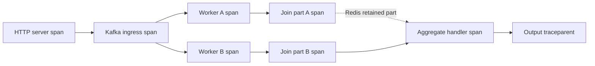

# Distributed tracing with OTLP and Jaeger

Install `pip install '.[tracing]'` and configure:

```dotenv
QSINT_ENABLE_TRACING=true
QSINT_OTLP_ENDPOINT=http://localhost:24317
QSINT_OTLP_INSECURE=true
QSINT_SERVICE_NAME=my-pipeline-worker
```

The compose stack maps Jaeger's OTLP gRPC port 4317 to host 24317 and its UI to [localhost:26686](http://localhost:26686). Use TLS and your collector endpoint outside this local stack. The framework initializes a process-owned provider during startup and flushes it on graceful shutdown. Configure tracing once per process; multiple independently configured providers/services in the same process are not supported. Shutdown flushing does not guarantee delivery after SIGKILL or an unavailable collector.

## Application spans

```python
from framework.decorators import kafka_handler
from framework.tracing import get_tracer


@kafka_handler(name="enrich", topics_in=["events.in"], topics_out=["events.out"])
async def enrich(message, consumer_name, metadatas):
    with get_tracer().start_as_current_span("application.enrich") as span:
        span.set_attribute("application.stage", "enrich")
        return {**message, "enriched": True}
```

HTTP middleware extracts incoming W3C headers. Kafka processing extracts `traceparent`/`tracestate`, creates a processing span and injects its context into downstream output. Sync workers receive copied context in their executor. Manual publishing from HTTP/application code must pass injected headers:

```python
from framework.tracing import inject_trace_headers

await producer.send_and_wait("events.in", encoded_json, headers=inject_trace_headers())
```

The same helper names, `tracer` proxy, standard span methods and no-op tracing types remain available. Using `get_tracer()` when tracing is disabled is safe. Outbound HTTP clients require their own OpenTelemetry instrumentation or explicit propagation; the framework cannot propagate headers for arbitrary external libraries automatically.

## Fanout, joins and bulk



A fanout injects the current trace into both branches; every downstream span keeps the same trace ID. A join's handler is parented to the arrival completing the aggregate. The earlier arrival is visible elsewhere in the same trace; the framework does not currently persist all upstream span contexts in Redis and create a multi-parent join. Independently rooted inputs can have different trace IDs; a join does not rewrite their history into a single trace.

Bulk processing uses the first input as its parent and links other valid source contexts. Outputs whose preserved `id` matches an input receive a producer span parented to that input, linked to the batch span; they retain their own trace IDs. Newly synthesized/changed output IDs fall back to the batch context. Keep IDs stable for unambiguous bulk lineage. A DLQ record preserves its source trace even when other records in the batch belong to other traces. Unit regressions cover distinct trace IDs in successful bulk outputs and failed bulk DLQ records.

## Real collector verification

```bash
docker compose -p qf-fastapi-test up -d --wait
QF_JAEGER=1 python -m pytest tests/test_otlp_jaeger.py -v
```

This test launches four independent processes, calls an actual HTTP endpoint, traverses Kafka fanout, two workers and a Redis-backed join, and queries Jaeger's storage API after exporter flush. It verifies final Kafka headers match the HTTP trace ID, four services are present, all spans share that trace ID, one HTTP root exists, and all parent references resolve to spans in the trace. Proof is archived in [jaeger_verification.json](../benchmarks/results/jaeger_verification.json) and [jaeger_trace.json](../benchmarks/results/jaeger_trace.json). The verification JSON contains the current UI URL. Jaeger's development storage is ephemeral; the archived trace remains available after a container restart.
