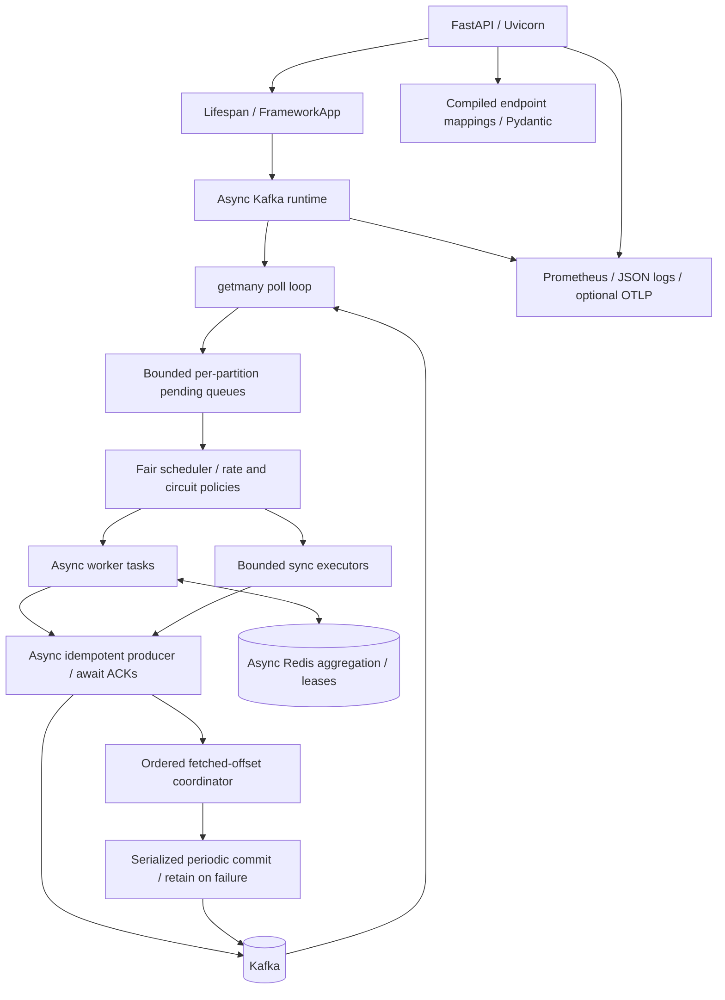

# Architecture

## Components

## Lifecycle and ownership

`FrameworkApp` constructs a FastAPI app and compiles routes without connecting to infrastructure. Lifespan configures observability and starts the ETL runtime. The runtime imports worker modules, snapshots their registrations, constructs clients and creates bounded executors for synchronous workers. Connections are established with retry budgets and a startup deadline. Startup errors close partially constructed resources and propagate to Uvicorn.

One event loop owns consumer state, scheduler state, completion bookkeeping and commit coordination. Broker heartbeats are managed by aiokafka. No worker thread may poll, seek, pause or commit. Shutdown stops fetching, drains queued and active work within a deadline, cancels unfinished tasks, commits only acknowledged contiguous progress, and closes producer, consumer, Redis, executors and tracing resources. Worker-only mode uses the same runtime and signal-driven stop path.

## Scheduling and backpressure

Each topic routes to one worker. Each assigned topic-partition has a bounded pending queue and an assignment generation. Workers have bounded active-job capacity; bulk jobs contain records from a single partition. The scheduler starts only jobs with capacity. Bulk batches flush on size or oldest-record age, including quiet topics. Async functions execute directly; synchronous functions execute in their worker's executor with context propagation.

The admission limit counts all fetched records awaiting a successful commit, including finished records behind an unfinished predecessor. This prevents a slow offset from growing a completion set without bound. The runtime pauses full partitions, retains broker heartbeats, seeks to the first unadmitted fetched offset and resumes once capacity is available. Rate limits count dispatched jobs, including bulk jobs, and circuit recovery admits a single half-open probe.

## Commit coordinator

For each generation, track the sequence of actual fetched offsets and their completion states. Completion may arrive out of order. A commit candidate is one plus the last completed offset in the completed prefix of fetched records. Gaps in numeric offsets are permitted; gaps in fetched-record completion are not.

Commit calls are serialized. A candidate snapshot is removed only after commit acknowledgement and only if its generation still matches. A failed commit retains the same candidate for the next attempt. Revocation drains active work for a bounded interval, commits completed progress, cancels remaining jobs, and discards the revoked generation. Late completions cannot advance a new assignment.

## Processing and retry boundaries

Decode a Kafka value once, require a JSON object, and derive a stable message ID from source coordinates if absent. Call the worker with isolated input/metadata copies. On handler exception, retry with capped exponential full jitter. After exhaustion, publish a diagnostic DLQ envelope and wait for acknowledgement. A `None` result is a successful filter.

Publish all outputs asynchronously, then wait for every acknowledgement before completing input records. Retry transport operations separately so a temporary producer error does not unnecessarily rerun successful user code. Output or DLQ failure after the transport budget terminates the runtime and makes readiness false. Replay is then driven by uncommitted source offsets.

At-least-once delivery permits duplicates when a process dies between output acknowledgement and input commit. Producer idempotence reduces duplicate sends within a producer session; it does not make user side effects, multiple topics, Redis and Kafka atomic. Applications must use stable identifiers and idempotent downstream operations.

## Aggregation

Redis Lua atomically stores a part by input topic and attempts a token-based lease when all required topics exist. Keys are scoped by consumer group, worker and correlation key, using a shared Redis cluster hash tag for related keys. Merge precedence follows the declared `topics_in` order. A lease heartbeat renews ownership while processing. Concurrent complete arrivals wait/retry rather than acknowledge a part that a failed owner might otherwise strand.

After successful output or DLQ acknowledgement, a token-checked script records a completion tombstone and removes parts and lease. Failures release only the caller's lease and retain parts. Tombstone TTL and aggregate TTL are bounded by worker configuration. Incomplete parts are acknowledged after Redis storage; durable recovery therefore depends on Redis persistence and availability. Expired incomplete joins are intentionally discarded; operators need a retention policy matching their business window.

## HTTP and observability

Dynamic mapping compilation resolves imports once, validates schemas and creates typed FastAPI routes. Async handlers receive Starlette requests; a compatibility adapter exposes parsed body/query/header conveniences for legacy handlers. Sync handlers run off the event loop. HTTP metrics use route templates, including a fixed unknown-route label. Request IDs are bounded and sanitized. JSON logs carry IDs and active trace context. Kafka headers explicitly extract/inject W3C context at each worker boundary. Tracing is optional and exporter setup occurs during lifespan.

The package owns no global logging handlers or network resources at import. Each app/runtime has its own metrics registry and clients. Worker declaration remains module-level for source compatibility; runtime snapshots registrations, so independent applications sharing a process must use distinct module registries or carefully isolate registrations.

## Design rationale

FastAPI supplies ASGI lifecycle and generated schemas. aiokafka and redis.asyncio remove broker/Redis blocking from worker threads. Per-worker sync executors preserve existing integrations without blocking native async workloads. Manual, ACK-gated commits replace unsafe fire-and-forget completion. In-memory scheduled retries avoid immediate retry-topic loops and keep original source identity, at the cost of attempt counts restarting after a process crash. Explicit bounds and generation fencing make failure recovery reviewable and testable.
