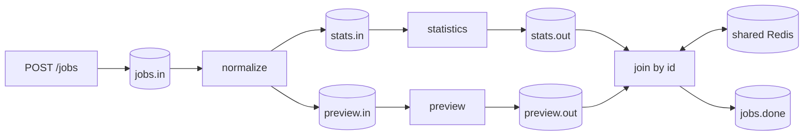

# Learn QF through runnable examples

Start with HTTP, run a complete pipeline, inspect failures and traces, then try replicas. Commands run from the repository root with the same virtual environment active in each terminal. The old Flask distribution requires a separate environment: both packages export `framework`.

## 1. Run HTTP without infrastructure

```bash
python3 -m venv .venv
source .venv/bin/activate
pip install -e '.[dev,tracing]'
uvicorn examples.app:app --host 127.0.0.1 --port 4000 --workers 1
```

[Config](config.py) disables workers by default, so Kafka/Redis are unnecessary. A root `.env` can override it; keep `QSINT_ENABLE_ETL=false` for this step. Open `http://localhost:4000/docs`, then inspect health and metrics:

```bash
curl http://localhost:4000/health/ready
curl http://localhost:4000/metrics
```

[app.py](app.py) bridges uppercase Config and [endpoint JSON](maps/endpoint.json) into FastAPI. Its handlers demonstrate native async requests and the legacy request adapter. The ASGI lifespan owns startup and cleanup.

An endpoint's `model_name` can be `null` or omitted. The top-level `models` can be `null` or omitted, and a named model can have a `null` definition. Those routes accept optional unvalidated JSON; malformed JSON still returns HTTP 400. Use a typed model when application validation matters.

Stop this server with Ctrl-C before using port 4000 below.

## 2. Start the complete pipeline

```bash
docker compose -p qf-fastapi-test up -d --wait
python -m examples.pipeline.client create-topics
uvicorn examples.pipeline.app:app --host 127.0.0.1 --port 4000 --workers 1
```

The stack provides Kafka `localhost:29092`, Redis `localhost:26379`, Jaeger UI `http://localhost:26686` and OTLP gRPC `localhost:24317`. It runs one Kafka broker for development. Topic provisioning is repeatable and preserves existing topics; it does not resize or validate existing topic configuration.

The complete application explicitly enables workers, reads process environment and ignores the root `.env`. In another terminal, activate the same environment and run:

```bash
python -m examples.pipeline.client run --jobs 3 --timeout 60
```

Expect `{"verified": 3, "topic": "qf.demo.jobs.done"}`. The client submits fresh IDs and verifies normalized text, word count, preview and completion. A second run ignores historical outputs with different IDs. This functional client stops when requested IDs arrive; integration tests additionally check committed offsets and duplicate windows.

## 3. Understand the stage boundaries



Every topic uses the `qf.demo` prefix. Kafka persists stage boundaries so restarted workers replay unfinished inputs. Normalization fans out the same job to independent branches. Redis retains the first branch until the other arrives, coordinates join ownership across replicas and temporarily remembers completed correlations.

| File | Purpose | Adapt it for |
|---|---|---|
| [pipeline/topics.py](pipeline/topics.py) | Shared namespace/topic contract | Your application's stage names |
| [pipeline/workers.py](pipeline/workers.py) | Four deterministic transformations | Async integrations and business logic |
| [pipeline/app.py](pipeline/app.py) | Schema, acknowledged ingress and composed lifespan | HTTP API and owned resources |
| [pipeline/client.py](pipeline/client.py) | Local provisioning and result checks | Expected business outputs |

HTTP 202 means Kafka acknowledged ingress, not that the job finished. A submission timeout can be ambiguous. Repeating an HTTP request creates a new Kafka record unless your application implements request idempotency.

## 4. Adapt the worker declarations

```python
from framework.decorators import kafka_handler


@kafka_handler(
    name="enrich", topics_in=["orders.in"], topics_out=["orders.enriched"], max_workers=8
)
async def enrich(message, consumer_name, metadatas):
    return {**message, "enriched": True}


@kafka_handler(
    name="join-order",
    topics_in=["orders.priced", "orders.checked"],
    topics_out=["orders.done"],
    aggregator=True,
    aggregate_by="order.id",
    aggregator_timeout_sec=300,
    max_workers=8,
)
async def join_order(message, consumer_name, metadatas):
    return {**message, "complete": True}
```

`aggregator=True` defaults to the `id` field. A dotted `aggregate_by` such as `order.id` also selects aggregation. The existing `@kafka_aggregator` remains supported. Every branch needs the same nonempty scalar value; missing keys route to DLQ. Numeric/string values normalize to strings. Aggregation and bulk mode cannot be combined.

The join merges one payload per input topic in configured topic order. It is not an arbitrary count/window aggregator. Use fresh IDs for independent joins: completion tombstones suppress reused keys during the configured timeout, and reused IDs can mix incomplete branch parts.

[workers.py](workers.py) demonstrates standalone single, bulk and legacy join declarations. Bulk handlers receive lists and may return lists. Preserve IDs for correlation and trace lineage. Async handlers must use async clients; bounded synchronous handlers provide compatibility. `max_workers` counts active jobs per process, so bulk jobs can each hold many records.

Workers acknowledge outputs before input completion. Returning `None` intentionally filters input. Exceptions receive bounded handler retries and then acknowledged diagnostic DLQ. Transport retries preserve known ACKs and pending receipts across attempts.

## 5. Inspect a failure

```bash
curl -i http://localhost:4000/jobs -H 'Content-Type: application/json' \
  -d '{"id":"demo-invalid-001","text":"   "}'
docker compose -p qf-fastapi-test exec -T kafka \
  /opt/kafka/bin/kafka-console-consumer.sh \
  --bootstrap-server kafka:9092 --topic qf.demo.dlq --from-beginning --max-messages 1
```

Whitespace passes the HTTP minimum length but fails normalization: three attempts precede DLQ. Empty/missing text fails HTTP validation before publication. The console command waits if no DLQ record exists. Decode and repair the diagnostic envelope's raw payload before replaying; the envelope itself is not a normal job. Retry counts reset after process loss.

## 6. Follow a trace

Restart the pipeline server with tracing enabled:

```bash
QSINT_ENABLE_TRACING=true QSINT_OTLP_ENDPOINT=http://localhost:24317 \
QSINT_OTLP_INSECURE=true QSINT_SERVICE_NAME=qf-demo-pipeline \
uvicorn examples.pipeline.app:app --port 4000 --workers 1
```

Submit a valid job using curl, then open `http://localhost:26686/trace/<trace_id>` using its returned ID. Allow a short exporter delay. HTTP ingress, fanout branches and the completing join share the trace ID via Kafka headers. Application spans use the existing `get_tracer().start_as_current_span(...)` pattern. The [collector test](../docs/Tracing.md) verifies propagation through four separate services.

## 7. Scale and restart workers

Stop the previous server, then run:

```bash
uvicorn examples.pipeline.app:app --port 4000 --workers 4
```

Each process owns its clients; the shared consumer group divides partitions and shared Redis coordinates joins. Prefer one process per pod in Kubernetes. Keep consumer group, worker names, join contracts and Redis endpoint stable across replacements. Changing the group creates an independent subscription. Four partitions per topic bound active consuming replicas for that topic; concurrent jobs can reorder outputs.

Enable `QSINT_IDEMPOTENCY_ENABLED=true` to record completed non-aggregator source coordinates in Redis. This suppresses replay within its TTL, but does not deduplicate business IDs published at new offsets. Joins already use correlation tombstones. A kill between output ACK and completion storage can still duplicate an output. Committed incomplete join parts require Redis retention and durability.

```bash
QF_INTEGRATION=1 python -m pytest tests/test_horizontal_recovery.py tests/test_crash_recovery.py -v
```

These destructive checks use independent processes and unique topics on the dedicated stack. Read [scaling and recovery](../docs/Scaling.md) for results, deployment probes and durability limits.

## 8. Explore execution leases and performance

```bash
python -m examples.single_execute
```

Five competing calls produce one execution and four skips. The caller owns the Redis connection. Read [the utility guide](../docs/Utilities.md) before wrapping workers: a skipped `SingleExecute` call defaults to `None`, which is successful filtering.

The [comparison report](../docs/qf_flask_vs_qf_fastapi_report.md) includes 1,000/100,000-message results; the [benchmark guide](../benchmarks/README.md) supplies reproducible commands. Demo client timings are not framework benchmarks. The [full pipeline walkthrough](pipeline/README.md) explains custom namespaces and expected outputs in more detail.

Use Ctrl-C for graceful shutdown. Keep infrastructure running while inspecting outputs/traces. `docker compose -p qf-fastapi-test down` stops this dedicated stack; `-v` deletes its data and is not routine recovery. Set a distinct `QF_DEMO_PREFIX` in both terminals before imports to isolate simultaneous demos. Use one example application per process because decorators register workers process-wide.
