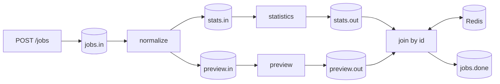

# HTTP → Kafka fanout → Redis join

This application accepts a text job, normalizes it, computes statistics and a preview on separate branches, then emits one merged result. Four workers run in one process for a short local setup. Kafka is the boundary between stages; Redis retains join parts.



Every topic is prefixed with `qf.demo` by default. The transformations are deliberately small and deterministic, so their results are easy to inspect. Replace branch bodies with your own async integrations; these transformations are not a performance benchmark.

## Run it

From the repository root, with the virtual environment activated:

```bash
pip install -e '.[dev,tracing]'
docker compose -p qf-fastapi-test up -d --wait
python -m examples.pipeline.client create-topics
uvicorn examples.pipeline.app:app --host 127.0.0.1 --port 4000 --workers 1
```

In another terminal, activate the same virtual environment and run:

```bash
python -m examples.pipeline.client run --jobs 3 --timeout 60
```

The command submits fresh UUIDs through HTTP, consumes `qf.demo.jobs.done`, and verifies normalized text, word count, preview and completion for every submitted ID. It ignores historical outputs with different IDs, rejects duplicates observed while collecting, and exits with an error on invalid output or timeout. The final line is:

```json
{"verified": 3, "topic": "qf.demo.jobs.done"}
```

Output collection ends when the requested IDs are received; this client does not certify the absence of later duplicates or source commits. Use the [integration and benchmark suites](../../docs/Testing.md) for those checks. Startup may take a few seconds for consumer-group assignment.

## Submit a job directly

```bash
curl -i http://localhost:4000/jobs \
  -H 'Content-Type: application/json' \
  -d '{"id":"example-job-001","text":"  hello async pipeline  "}'
```

HTTP **202** means Kafka acknowledged the ingress record. The response includes topic, partition and offset; it does not mean the pipeline finished. With tracing disabled, `trace_id` is `null`. Omitting `id` generates a new UUID. The final Kafka result has these application fields:

```json
{
  "id": "example-job-001",
  "text": "hello async pipeline",
  "statistics": {"words": 3},
  "preview": "HELLO ASYNC PIPELINE",
  "complete": true
}
```

Additional framework fields may be present. Give every independent job a fresh ID: the join suppresses repeated completed correlations for 300 seconds. This is not a durable HTTP idempotency API. Reusing an ID with different text can mix branch parts. A timed-out POST can already have reached Kafka; callers must apply their own acceptance/retry policy.

## Configuration

The demo ignores `.env` to keep it separate from the older bundled example, but reads process environment variables. Set the same broker and prefix in both terminals **before** importing the application or invoking the CLI:

```bash
export QF_DEMO_PREFIX=qf.demo.alice
export QSINT_KAFKA_BOOTSTRAP_SERVERS=localhost:29092
export QSINT_REDIS_URL=redis://localhost:26379/0
python -m examples.pipeline.client create-topics
```

`QF_DEMO_PREFIX` changes topic names, worker names and the default consumer group, isolating concurrent runs. `QSINT_CONSUMER_NAME` overrides the group. Other standard settings, such as `QSINT_PENDING_MAX_PER_TP`, remain available. The local ingress client and CLI use plaintext Kafka; security-enabled applications should construct clients with the same security options as their worker runtime.

The topic provisioner creates four partitions per topic and replication factor one. Rerunning it preserves existing topics; it does not resize them or validate their existing configuration. Production topic provisioning belongs to your infrastructure process.

## Trace a complete job

Start the server with tracing enabled:

```bash
QSINT_ENABLE_TRACING=true \
QSINT_OTLP_ENDPOINT=http://localhost:24317 \
QSINT_OTLP_INSECURE=true \
QSINT_SERVICE_NAME=qf-demo-pipeline \
uvicorn examples.pipeline.app:app --port 4000 --workers 1
```

Submit a job and open `http://localhost:26686/trace/<trace_id>` using the returned non-null trace ID. Allow a short exporter delay or stop the server gracefully to flush. HTTP ingress uses `KafkaClient.put_message()`, which injects W3C headers; downstream propagation is automatic. All branches should share the HTTP trace ID. This demo has one service process, so Jaeger shows one service with several spans. The [four-process collector test](../../docs/Tracing.md#real-collector-verification) verifies propagation across independently running services.

## Inspect failures and health

```bash
curl http://localhost:4000/health/ready
curl http://localhost:4000/metrics
docker compose -p qf-fastapi-test exec -T kafka \
  /opt/kafka/bin/kafka-console-consumer.sh \
  --bootstrap-server kafka:9092 --topic qf.demo.dlq --from-beginning --max-messages 1
```

A nonempty but whitespace-only `text` passes the ingress schema and fails normalization, exercising three handler attempts followed by a diagnostic DLQ. Empty text or a missing text field returns HTTP 422 before Kafka publication. The DLQ console command waits if there is no record. For a custom prefix, substitute its DLQ topic.

Use Ctrl-C for graceful shutdown. Stop only the application if you want to keep inspecting Jaeger. `docker compose -p qf-fastapi-test down` stops this development stack; adding `-v` also deletes its persisted data. Do not use data deletion as routine pipeline recovery.

## Files to adapt

- [app.py](app.py): settings, composed lifespan, schema and HTTP publication deadline.
- [workers.py](workers.py): four registered transformations with stable IDs.
- [topics.py](topics.py): shared topic contract and namespace.
- [client.py](client.py): local provisioning and bounded output validation.

For a production application, provision replicated topics separately, define authentication and downstream business idempotency, and select Redis persistence and retention appropriate to your join contract. See [operations](../../docs/Operations.md) for the implemented recovery behavior.
